

  
  <h1>Wemory</h1>
  
本地读取、浏览、备份与导出微信数据的 Windows 桌面工具

  

    <a href="https://wemory.chituhub.com">产品官网</a> ·
    <a href="https://wemory.chituhub.com">下载最新版</a> ·
  

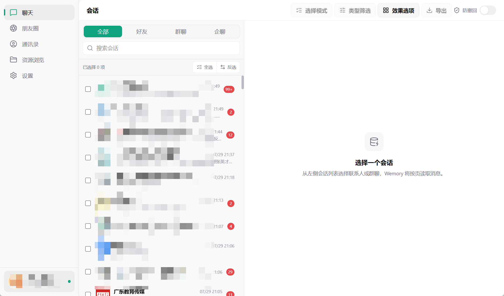

## Wemory 能做什么

Wemory 面向希望在自己的电脑上整理微信资料的用户。应用在本机读取和处理微信数据，帮助你集中浏览并按需导出：

- 聊天记录：浏览私聊、群聊和企业会话，导出为 HTML 或 PDF。
- 朋友圈：按时间浏览朋友圈内容，导出为 HTML 或 PDF。
- 通讯录：查看联系人，并将联系人和群成员导出为 XLSX。
- MCP 服务：让本机 AI 客户端通过 MCP 读取聊天、联系人与朋友圈数据。
- 批量语音转文字：把会话里的语音批量识别为可搜索、可导出的文字。

## 本地优先

微信数据的读取、解密和导出默认均在本机完成，不上传聊天数据或用户信息。联网仅用于应用更新及下载必要组件；唯一的例外是「批量语音转文字」：只有你主动开启并确认授权后，所选语音的音频才会逐条发送到你自己配置的阿里云百炼接口。音频内容无法脱敏，使用前请确认自己有权处理这些语音。导出文件由你自行选择保存位置。

## 聊天记录导出

Wemory 会将微信会话按好友、群聊和企业会话分类，支持搜索、类型筛选和批量选择。你可以在导出前直接浏览消息内容，并按日期范围导出指定会话。

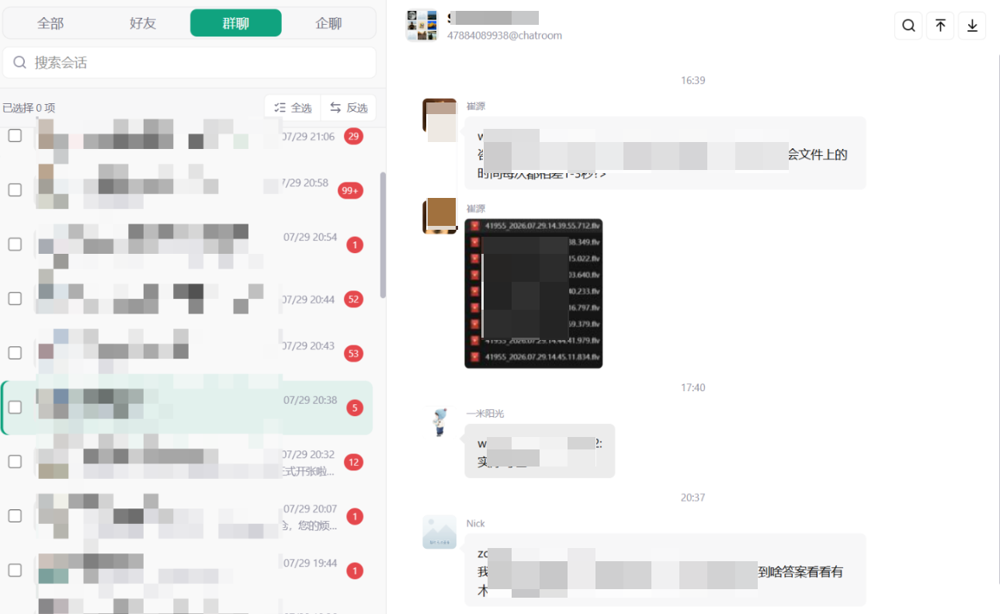

聊天记录支持文本、图片、视频、语音、表情、附件和折叠消息等常见类型。图片使用原图导出，未下载的视频也会显示封面，便于离线查看和归档

## 通讯录的导出

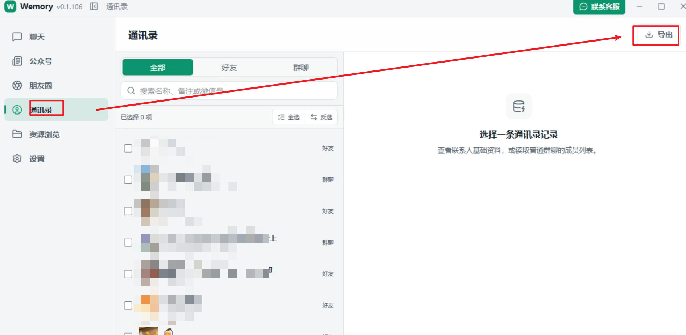

效果如下： 标签，群昵称，好友资料（手机号）都 有
 

## MCP 功能

Wemory 可以作为本机 MCP 服务运行，让支持 MCP 的 AI 客户端读取你本机已有的聊天记录、联系人和朋友圈数据。在「设置 → AI 工具 → MCP 服务」开启服务，设置一个固定端口（例如 38471），状态显示「运行中」即可使用。

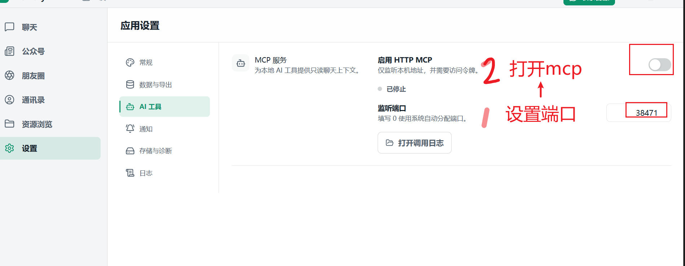

服务只监听 `127.0.0.1`，访问令牌不要公开或写入日志。仓库提供 [`wemory-mcp-setup/SKILL.md`](wemory-mcp-setup/SKILL.md)，可让 AI 自动发现本机连接、生成 Codex 或 WorkBuddy 的客户端配置（写入前备份原有配置），并验证服务是否正常。

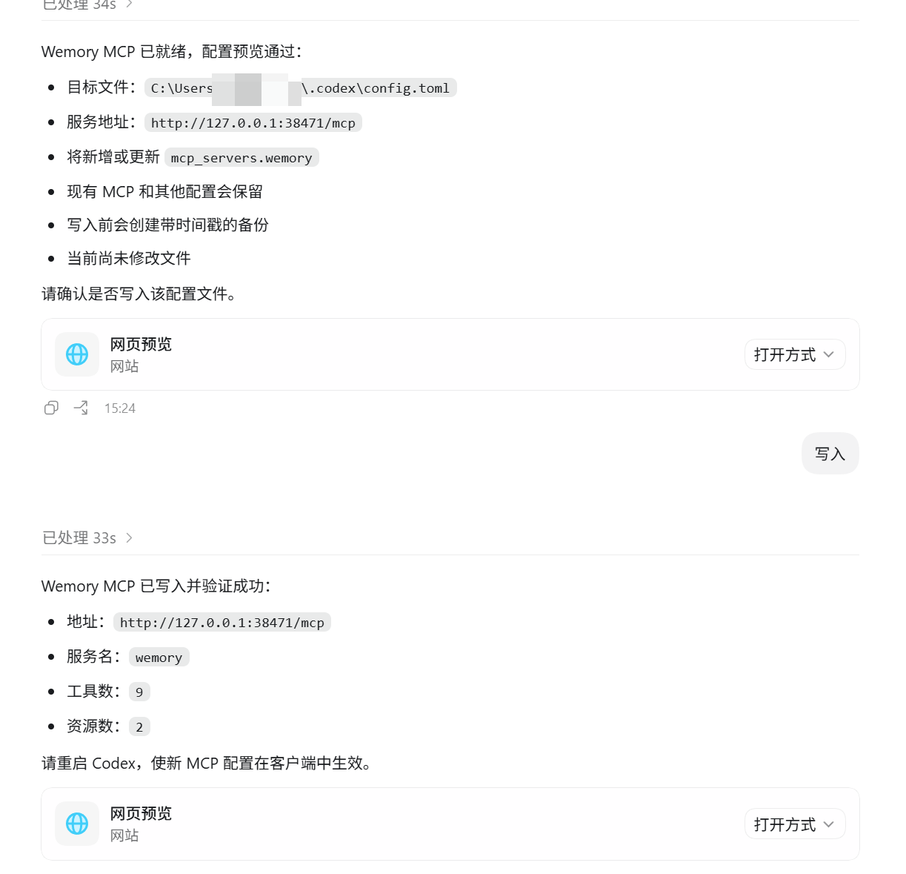

连接后可以直接向 AI 提问，例如「查找我和张三最近 20 条聊天记录」。MCP 只读取本机已有数据，不修改微信数据；具体可用工具以客户端连接结果为准。

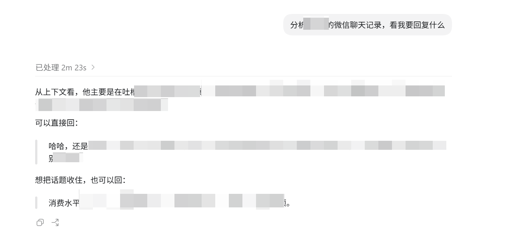

## 批量语音转文字

微信客户端只能逐条手动把语音转成文字。Wemory 支持选定一个会话和日期范围，一次性把尚未转成文字的语音交给语音识别服务处理，结果回填到聊天气泡，并可用于会话搜索、导出、归档和后续分析。

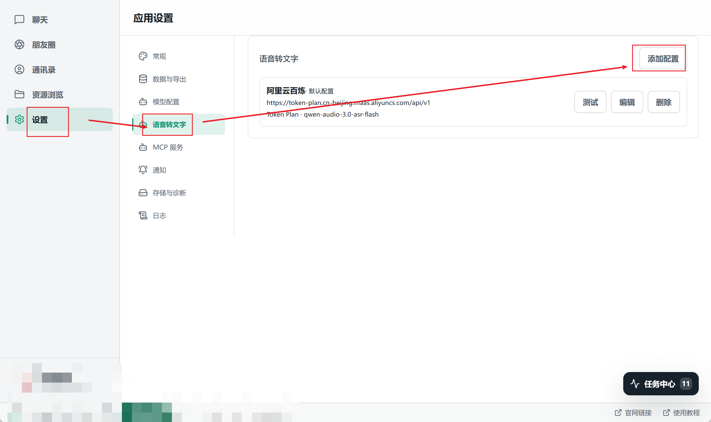

目前支持阿里云百炼（通义千问）的语音识别模型，提供两种接入方式：

- 按量付费：支持 `qwen-audio-3.0-asr-flash` 与 `qwen-audio-3.1-asr-flash`，可选北京（默认）或新加坡地域，使用对应地域的普通百炼 API Key。
- Token Plan：使用套餐专属地址，仅支持 `qwen-audio-3.0-asr-flash`，使用 `sk-sp-` 开头的套餐 API Key。

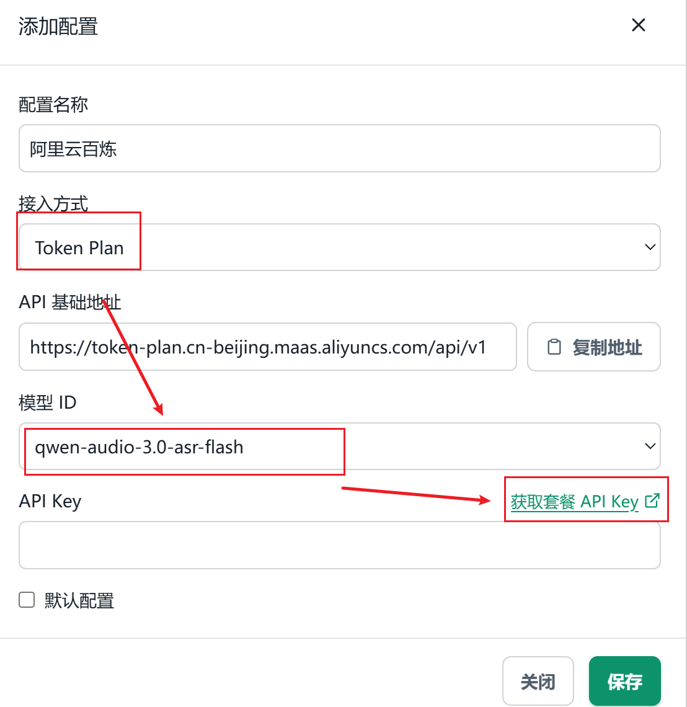

开始转写前可先「预检」：它只读取本地消息，显示待转写条数和预计总时长，不上传音频。确认后再勾选授权并启动；单次最多转写 1,000 条，范围内超过 20,000 条时需要缩小日期范围。任务可在「任务中心 → 语音转文字」查看进度、日志和失败明细，并暂停、继续、取消或重试失败项。

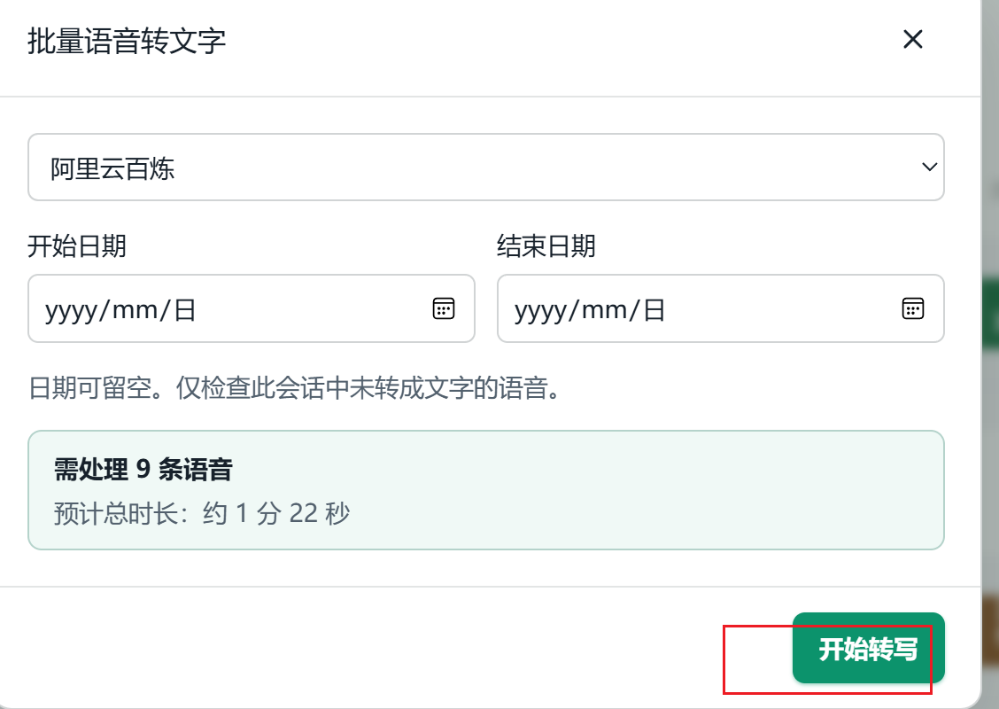

完成后语音气泡会显示「阿里云转写」文本，可手动校正。已生成的导出文件与历史分析不会自动改写。配置里的「测试」只发送一段内置样音，不读取聊天语音，但可能产生少量费用；API Key 通过 Windows DPAPI 加密保存在本机。

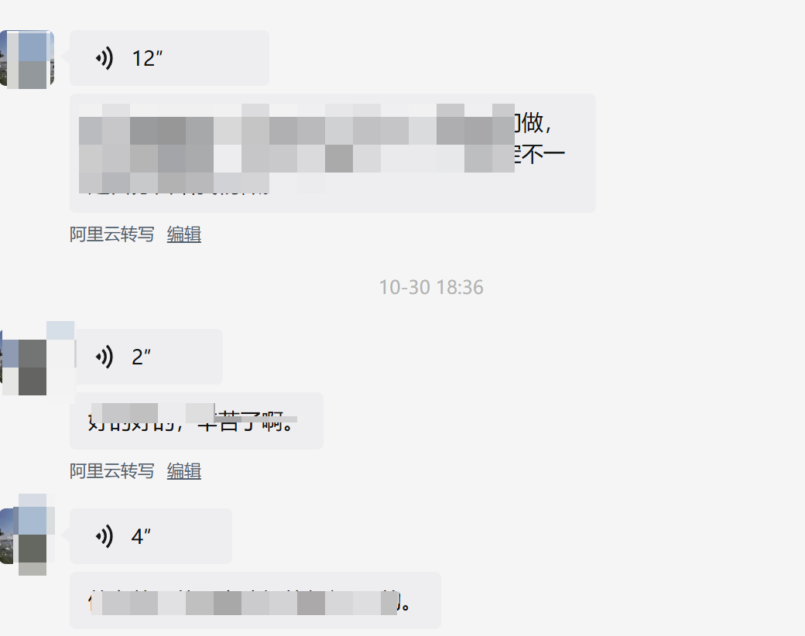

## 下载与安装

1. 前往 [Releases](https://wemory.chituhub.com) 下载
2. 在 Windows 10 或 Windows 11 x64 上运行安装程序。
3. 启动 Wemory，按照界面提示连接本机微信数据目录。

当前安装包尚未使用 Windows 代码签名证书签名，因此系统可能显示 Microsoft Defender SmartScreen 提示。

## 更新记录

### 2026.11.20 批量语音转文字

1. 新增「批量语音转文字」：选定会话与日期范围，批量把语音交给阿里云百炼识别，结果回填聊天气泡。
2. 支持按量付费与 Token Plan 两种接入方式，可配置地域、模型与 API Key，并提供配置测试。
3. 增加预检统计、任务中心（进度 / 日志 / 失败重试）与转写结果手动校正；结果可用于搜索、导出和归档。
4. 说明文档补充 MCP 功能与批量语音转文字的使用方式；隐私说明明确语音转写是唯一需要主动授权并发送音频到第三方接口的功能。

### 2026.8.23 资源刷新

在微信中打开尚未加载的图片或语音后，无需重启 Wemory。在聊天记录或朋友圈页面点击刷新按钮，即可重新读取已经下载到本机的资源。

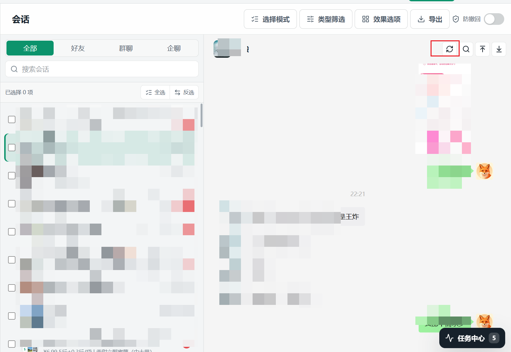

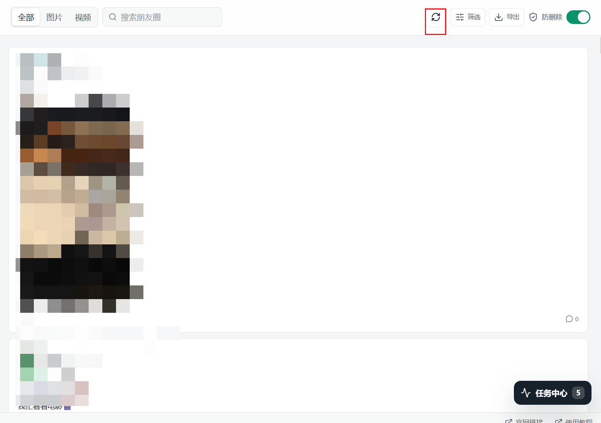

### 2026.8.22

1. 群联系人导出，增加朋友资料(电话号) 支持多个手机号

### 2026.8.21

1. 公众号增加采集：阅读量，评论数，点赞数的采集
   
### 2026.8.19:

1. 本地的聊天数据和通讯录数据可以归档
2. 归档支持增量归档
3. 增加归档查看工具，可以查看你的归档
   在做

### 2026.8.14

1. 增加 MCP 功能，可以通过 AI 读取聊天记录。
   1. 本机 HTTP MCP 服务，只监听 `127.0.0.1`，需在设置中启用并设置固定端口。
   2. 提供 Codex / WorkBuddy 配置技能与连接验证脚本，写入客户端配置前会先备份。
2. 增加多账号支持。

### 2026.8.13

1. 修复公众号采集数据不完整的问题。
2. 优化聊天消息中的部分图标。
3. 支持聊天消息中的附件类型。
4. 支持聊天消息中的表情符号。
5. 支持聊天消息中的视频类型。
6. 修复语音消息无法打开的问题。
7. 修复聊天图片未使用原图导出的问题。
8. 支持折叠消息类型的显示。
9. 修复未下载的视频不显示封面的问题。
10. 导出联系人时包含对应标签。

## 系统要求

- Windows 10 / 11 x64
- 已在本机登录并产生数据的 Windows 微信客户端

## 说明

本仓库用于发布 Wemory 产品介绍、截图和安装包，不包含应用源代码。Wemory 不是微信官方产品，与腾讯或微信不存在隶属或合作关系。请仅处理你有权访问的数据，并遵守当地法律法规及相关服务条款。

问题反馈请使用本仓库的 [Issues](https://github.com/ftyszyx/wemory-wechat-backup/issues)。
